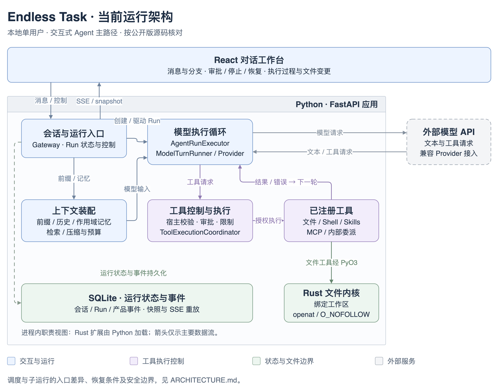

# 当前运行架构

本文说明公开版本已接线的实现及其边界。图聚焦本地单用户的交互式 Agent 路径；框表示同一 FastAPI 应用中的职责，Rust 通过 PyO3 作为进程内库加载。

[查看矢量图](.images/runtime-overview.svg) · [可编辑图源](.images/runtime-overview.drawio)

## 一次交互如何执行

1. React 工作台通过 HTTP 提交消息或运行控制。Gateway 管理会话、Lane、Run 与幂等提交。
2. Gateway 的前缀构建回调与记忆注入、Executor 的历史投影和上下文预算规划共同组装模型输入。“上下文装配”是这些职责的概括，不是一个独立服务。
3. `AgentRunExecutor` 驱动模型轮，`ModelTurnRunner` 经 Provider 请求外部模型 API，取得文本或工具请求。
4. 宿主校验工具参数、审批和调用限制，再调度已注册工具。模型不会直接执行文件操作或 shell。
5. 工具结果与错误进入运行上下文，供下一轮模型使用；文件工具经 Python 适配层调用 PyO3 / Rust 内核。
6. Gateway 与执行过程通过仓储持久化运行状态、产品事件和执行记录。图中只保留代表性的持久化连线，不枚举各模块的仓储访问。
7. 会话接口先返回快照，再按产品事件游标投影 SSE 更新。浏览器断线后的显示恢复依赖已保存的事实。

图中的“工具控制与执行”概括了协调器与工具平台的职责。当前自动批准的批次与需要审批的逐项调用有不同执行路径，不能将概览理解为每个工具都经过同一条 Pipeline。

| 职责 | 源码入口 |
|---|---|
| HTTP 消息与快照 / SSE | [v2_conversations.py](apps/api/src/endless_task/api/routes/v2_conversations.py) |
| Gateway 提交、前缀与执行器装配 | [gateway_impl/runs.py](apps/api/src/endless_task/runtime_v2/gateway_impl/runs.py)、[api/wiring.py](apps/api/src/endless_task/api/wiring.py) |
| 模型轮与上下文选择 | [execution_impl/runner.py](apps/api/src/endless_task/runtime_v2/execution_impl/runner.py)、[turns.py](apps/api/src/endless_task/runtime_v2/execution_impl/turns.py)、[context_segments.py](apps/api/src/endless_task/runtime_v2/execution_impl/context_segments.py) |
| 工具协调与控制 | [execution_impl/coordinator.py](apps/api/src/endless_task/runtime_v2/execution_impl/coordinator.py)、[tool_platform/](apps/api/src/endless_task/tool_platform/) |
| 状态与事件仓储 | [storage/v2/](apps/api/src/endless_task/storage/v2/) |

## 三个设计取舍

### 模型提出动作，宿主决定执行

工具请求只是执行意图。参数、可用工具、审批、调用限制与取消由宿主代码落实；模型输出不能替代这些检查。交互式 shell 默认逐次审批，文件写入和删除遵循各自工具策略。

源码：[工具协调器](apps/api/src/endless_task/runtime_v2/execution_impl/coordinator.py)。验证：[工具 Pipeline](apps/api/tests/test_tool_pipeline.py)、[Gateway 审批与控制](apps/api/tests/test_runtime_v2_gateway.py)。

### 显示重放与副作用执行分开

显示层读取历史事件；它不会因为客户端重新连接而再次执行工具。崩溃恢复、安全重试和预算硬停续跑分别处理，结果不确定的工具不会被自动重放。

同一 Run 的预算续跑只接受预算硬停形成的 `completed` 运行，并要求没有结果不确定的工具、同一 Lane 没有其他活动运行。普通完成、失败或取消不能使用该入口。

源码：[replay.py](apps/api/src/endless_task/runtime_v2/replay.py)、[revive.py](apps/api/src/endless_task/runtime_v2/revive.py)、[run_progress.py](apps/api/src/endless_task/runtime_v2/execution_impl/run_progress.py)。验证：[重放](apps/api/tests/test_runtime_v2_replay.py)、[续跑准入](apps/api/tests/test_runtime_v2_run_resume.py)、[预算续跑](apps/api/tests/test_runtime_v2_run_revive.py)。

### Python 编排，Rust 收紧文件访问边界

七类交互式文件工具通过 Python 适配层与 PyO3 调用 Rust 文件内核。内核逐段使用 `openat` / `O_NOFOLLOW` 解析路径，基于目录和文件句柄操作，防止符号链接替换造成的工作区越界。原生扩展不可用时文件能力明确失败；安装和验证命令通过 `verify_native.py` 检查 ABI，拒绝不匹配的构建。

这个边界覆盖已接入的交互式文件工具。网页保存、无人值守文件入口有各自实现；shell 的 OS 隔离需要另行配置 Seatbelt / container。

源码：[_native/fs.py](apps/api/src/endless_task/_native/fs.py)、[Rust 文件内核](apps/api/crates/endless-kernel-fs/src/lib.rs)。验证：[TOCTOU 回归](apps/api/tests/test_rk_fs_toctou.py)、[撤销与预读](apps/api/tests/test_rk_fs_undo_preread.py)、[绑定回归](apps/api/tests/test_rk_native_binding.py)、[原生加载及 ABI 检查](scripts/verify_native.py)。

## 图中未展开的入口

**任务调度。** `TaskScheduler → TaskWorker → 专用 AgentRunExecutor` 处理到期任务与提醒。该实例使用无人值守工具过滤、审批策略和任务预算；其上下文装配与交互入口存在差异。见 [tasks/](apps/api/src/endless_task/tasks/)、[运行装配](apps/api/src/endless_task/api/wiring.py)、[Worker 测试](apps/api/tests/test_task_worker.py)。

**内部委派。** 已注册工具提供 spawn / query / cancel / list / steer 等能力。子运行终态经 `ChildWakeupService` 调用 `gateway.send`，在父会话开启新 Run；这不构成 A2A 接入或子间直接通信。`isolated_write` 使用空 scratch 输出和显式 apply，不等同于完整项目快照或 Git worktree。见 [delegation/](apps/api/src/endless_task/delegation/)、[回流测试](apps/api/tests/test_delegation_wakeup.py)、[隔离成果应用测试](apps/api/tests/test_delegation_apply.py)。

**记忆与反馈。** 当前有作用域记忆注入和画像相关能力。旧记忆管理页面的编辑 / 删除与 v2 运行消费存在一致性缺口，不能据此承诺完整撤回；点赞 / 点踩保存反馈记录，尚未形成自动策略更新闭环。

## 图的维护

图源为 [.images/runtime-overview.drawio](.images/runtime-overview.drawio)，可用 draw.io 编辑；PNG 内也嵌入了图源。维护时同时更新 PNG、SVG 和本文中的实现说明，并对照同一公开代码版本核对。目标设计与待实施能力不加入本图。
