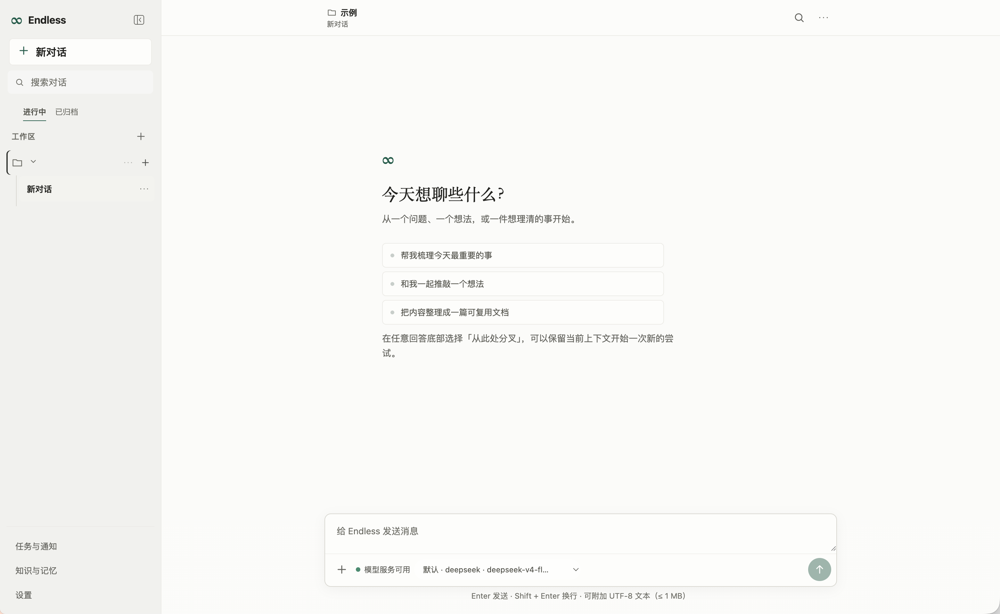
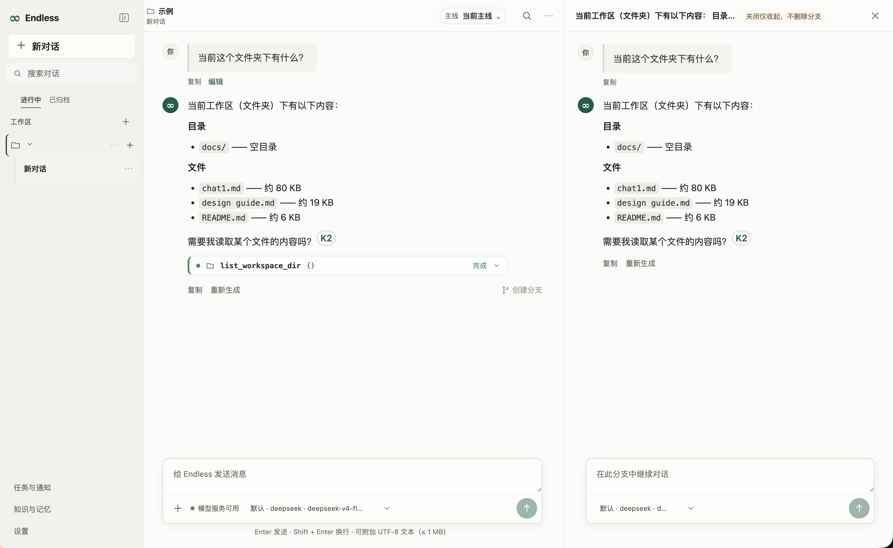

# Endless Task

> 本地优先、以聊天为主要入口的个人 AI 助手 Runtime。


Endless Task 围绕自研 Runtime v2 实现聊天、分支、工具执行、记忆、成果和任务调度。项目处于 **Product Acceptance Candidate** 阶段，仍在持续开发与验收。

## 为什么做这个项目

在使用 ChatGPT / Claude / Codex / Cursor 的过程中，我反复遇到一个问题：

> 我想保留当前上下文，同时开启新的探索、并行比较几个方案。新建对话会丢失上下文；在原对话中尝试第二条路，又会影响主线。

Endless Task 用**持久分支与临时对话**承载不同探索，让个人助手在共享必要上下文的同时保留清楚的执行边界。

## 核心能力

- **会话分支**：持久分支继承来源上下文并独立演化，支持重命名、设为主线和归档；临时对话隔离探索，不默认写入长期记忆，可升级为正式会话。
- **可靠执行**：持久化运行状态、SSE 事件重放、幂等提交、检查点、审批、取消与恢复。预算硬停后，仅满足安全条件的运行支持原地续跑。
- **Rust 文件内核**：通过 PyO3 接入交互式 Agent 的读取、写入、编辑、删除、列目录、路径管理和 Skill 文件读取；逐段 `openat` / `O_NOFOLLOW` 解析路径，拒绝符号链接替换造成的越界访问。扩展缺失或 ABI 不匹配时明确失败。
- **任务与委派**：任务和提醒的提案确认、手工创建与编辑、调度及通知；子运行支持后台执行、结果回传、只读 / 隔离写模式与预算限制。
- **离线评测**：对已录制运行计算确定性指标，导出报告并比较质量回退。`eval diff` 可供流水线调用，当前仓库 CI 尚未自动接入该门禁。

| 能力 | 说明 |
|---|---|
| 聊天 | SSE 流式回复、停止 / 重试 / 重新生成、断线恢复 |
| 文件与变更 | 文本附件、`@` 文件引用、受控文件工具、会话文件变更 diff |
| 记忆 | 提案确认、跨会话注入、来源 / 冲突 / 过期管理 |
| 成果 | 生成、版本管理、来源引用、继续修改与导出 |
| 任务与提醒 | 创建与编辑、调度、暂停 / 恢复 / 取消、运行复核与通知 |
| 知识 | 信息源管理、字面与语义混合检索、DuckDB 受控只读 |
| Skill / MCP | Skill 管理、MCP 服务器配置与重载、工具白名单及审批 |

## 界面预览

| 主界面 | 会话分支 / 临时探索 |
|---|---|
|  |  |

## 快速开始

macOS 优先。准备 Python 3.12、[uv](https://docs.astral.sh/uv/)、Node.js 24，以及通过 [rustup](https://rustup.rs/) 安装的 Rust 工具链。后端源码安装会编译 PyO3 扩展，仓库固定 Rust `1.98.1`；macOS 还需 Xcode Command Line Tools（`xcode-select --install`）。

在仓库根目录运行：

```bash
# 安装锁定的依赖并构建原生扩展
make install

# 启动 API（默认 FakeProvider，无需模型密钥）
make api
```

另开终端，在仓库根目录运行：

```bash
make web
```

打开 <http://127.0.0.1:5173>。FakeProvider 用于本地演示与自动化；真实模型需配置 DeepSeek / OpenAI-compatible Provider，密钥只在后端配置。

安装、数据目录、备份和模型配置见 [API README](apps/api/README.md) 与 [示例配置](apps/api/.env.example)；前端运行说明见 [Web README](apps/web/README.md)。

## 代码地图

| 关注点 | 入口 |
|---|---|
| Runtime 状态、执行与恢复 | `apps/api/src/endless_task/runtime_v2/` |
| HTTP / SSE 接口 | `apps/api/src/endless_task/api/app.py`、`api/routes/` |
| 持久化与迁移 | `apps/api/src/endless_task/storage/` |
| 子运行委派 | `apps/api/src/endless_task/delegation/` |
| 文件与终端工具 | `apps/api/src/endless_task/workspace_runtime/` |
| Rust 内核与 PyO3 适配 | `apps/api/crates/`、`apps/api/src/endless_task/_native/` |
| 离线评测 | `apps/api/src/endless_task/eval/` |
| 前端聊天与执行过程 | `apps/web/src/features/chat/` |
| 文件安全回归 | `apps/api/tests/test_rk_fs_toctou.py`、`test_rk_fs_undo_preread.py` |

## 关键设计决策

完整设计笔记属于作者私有资料，不在本仓库发布；这里呈现可对照源码核验的结论：

1. **区分恢复场景。** 崩溃恢复、安全重试与预算硬停续跑分别校验。只有预算硬停后处于 `completed`、没有结果不确定的工具、且同一 Lane 没有其他活动运行时，才允许同一条 run 原地续跑；普通完成、失败或取消不能走此入口。
2. **并发控制使用版本号与 CAS。** 状态变化遵循业务语义，避免只按时间戳决定覆盖顺序。
3. **重放读取历史，不重新执行工具。** 展示层断线恢复与副作用执行分离；结果不确定的工具调用不会因续跑自动重放。
4. **审批是执行前置条件。** 只读工具可自动执行，绑定工作区内的文件写入按工具策略执行；删除、shell 等危险或外部动作需审批，安全类评测规则不能被主观评分覆盖。
5. **记忆先提案、后确认。** 每条记忆保留来源并支持冲突与过期处理，减少错误信息污染长期上下文。
6. **评测优先采用确定性指标。** 同一批已录制数据可以重复打分，区分代码回退与模型随机性。

## 验证

| 检查项 | 运行方式 |
|---|---|
| Rust 与原生扩展 | 锁定工具链和 Cargo 依赖，显式检查扩展加载及 ABI，运行 Rust 测试 |
| 后端 | macOS、`TZ=Asia/Shanghai` 下运行 `unittest` |
| 前端 | Node.js 24、`npm ci`、production build 与 Vitest |
| 浏览器 E2E | Playwright 桌面 / 移动端旅程，手工运行，尚未接入 CI |
| 离线质量门禁 | 已录制运行的 `eval diff`，尚未接入 CI |

CI 配置见 [.github/workflows/ci.yml](.github/workflows/ci.yml)。安装后在仓库根目录运行：

```bash
make test
make build

# 首次运行 E2E 先安装 Chromium
(cd apps/web && npx playwright install chromium)
make e2e
```

测试范围和跳过原因以实际输出为准。原生扩展不可用时应先修复构建，不能把原生安全用例因缺少扩展而跳过当作验证通过。人工产品验收与发布验收另行进行。

## 离线评测 CLI

评测读取已录制的 v2 Run，不调用模型或工具；`eval run` 会持久化评测批次。进入 `apps/api` 后运行，以读取与 API 相同目录的配置：

```bash
cd apps/api
.venv/bin/endless-task eval run --require-tools
.venv/bin/endless-task eval report --batch BATCH
.venv/bin/endless-task eval export --batch BATCH --format jsonl
.venv/bin/endless-task eval diff --baseline A --candidate B --tolerance approval_gate=0.05
```

指标包括 `completion`、`tool_correctness`、`approval_gate`、`robustness`、`efficiency` 和 `loop_detected`。回退超出容差时，`eval diff` 返回非零退出码。

## 当前状态与边界

业务包版本保持 `0.5.0`，处于 **Product Acceptance Candidate** 阶段。源码中已有上述能力，但尚未完成 Product Accepted、Release Candidate 或 Release Ready 验收。人工产品体验、真实键盘 / 读屏和移动设备验收、真实旧库升级与降级演练、可复现发布及运行手册仍需完善。

- 仅支持本机单用户使用。API 和开发 Web 绑定 loopback，不应通过 `0.0.0.0`、端口转发或反向代理暴露到局域网 / 公网。
- `.env`、本地凭据文件、数据库、日志和用户文件不提交仓库；模型密钥只供后端使用，不能配置到前端环境变量。
- Rust 文件内核覆盖交互式 Agent 的文件工具；网页保存、未值守执行等入口有各自实现，不能视为所有文件操作都经过同一内核。
- shell 默认本机执行并逐次审批。Seatbelt / container 沙箱需显式配置并通过能力检查，Rust 文件内核不能替代完整 OS 隔离；当前 Rust 检索仍为同步调用。
- 浏览器面板仍是占位视图；本仓库未提供正式生产 Web 托管或桌面安装包。
- 默认无遥测。

## 设计参考

| 参考 | 借鉴 |
|---|---|
| Pi | Agent Runtime 的状态、恢复与工具调用边界 |
| Cherry Studio | 会话管理、知识库与多模型配置体验 |
| Codex / Cursor | 执行过程展示与可恢复执行 |

产品定位仍是个人助手，编程作为深入实践的领域之一。

## 开发方式

本项目使用 AI 辅助开发（Cursor 为主、Codex 为辅）：**AI 承担实现层，作者承担架构决策、状态机语义、分支与记忆模型、评估指标体系设计以及测试验收**。可以对照源码与测试核验实现。

## 使用与授权

© 2026 wj-spec. 保留所有权利。

本仓库作为**个人作品与能力展示**用途公开，欢迎阅读、克隆并在本地运行评估。
未经作者书面许可，不得用于商业用途、不得再分发。

---

*Endless Task 是一个个人驱动的研究型项目，目标是理解并实践「如何让一个 Agent 可靠地运行」。*
